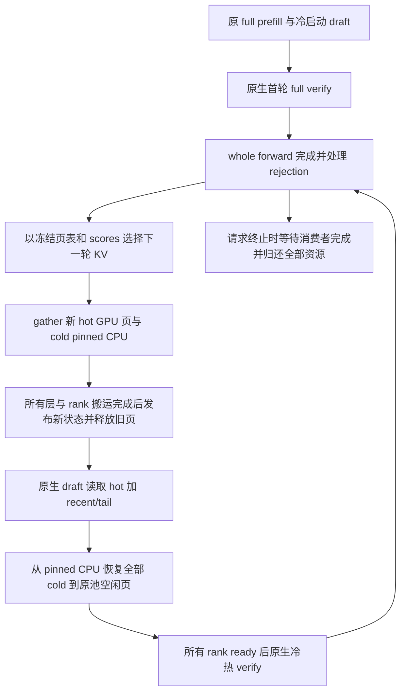

# SparseSpec compact KV 实施交接与源码复核（Astra / max）

日期：2026-10-14。交接对象：Astra，推理档位 max。源码核查基准：`aaffc0fa4bb92836fd042ababa1dfcf809e7b208`。

本文可独立用于下一会话。目标是让 compact KV 使用原 GPU 页池和原生计算路径，在 verify 边界实际搬运、卸载和恢复 KV，以降低 draft 阶段占用的 GPU 页数，并验证由此获得的并发收益。本文主体保留实施前的设计与验收要求；当前实施状态见下面的更新，不应将主体中的「待实施」直接解读为现有代码状态。

**实施更新（2026-10-14）：** Astra max 已完成 `kv_cache="compact"` 原生页池路径及验证：Qwen TP1/TP2 同序原生对照 logits 逐位一致，公开入口 TP1/TP2（含 temperature=.65）跑通，20K 受限池与真实 parked verify 生命周期通过。固定选择记录的 AIME 三轮计时完成，CPU offload 相对 compact resident 增加约 12.94% 端到端时间；尚未证明生产长上下文下的批量吞吐收益。完整前缀重算与额外 prefix 重排有单独保存的严格数值失败记录，不能声称所有对照均通过。本版作为异步与准入策略改进前的本地提交检查点。原生页池源码由 Astra max 实施；根代理随后新增完整 AIME 接受率扫描启动脚本并整理记录。当前接口见 [README_compact_native.md](../serve/attention/README_compact_native.md)，逐文件改动、证据及局限见 [本次报告](../log/kv-offload-native-review-20261014/report_zh.md)。

文中「已决定」表示用户已经确认的要求；「已核实」表示本轮读取当前源码或已有实验文件确认的事实；「待实施／待验证」表示下一版建议，不能当作现有功能。旧原型的通过记录只适用于旧原型。

最新授权（2026-10-14）：用户后续撤销 Astra 代理使用，由根代理直接推进并逐文件汇报。完整 AIME 扫描只运行最终 compact 版，全部30题，各 r=.05/.10/.15 一次，不追加三次重复、不重跑已有原生基线。最新 GPU 范围为4、5、6、7，TP=2，两组并行、第三档排队，全部产物写入仓库 `log/`。用户现已授权本地提交当前版本；不修改环境或模型数据。异步搬运、CPU异步调度、CUDA Graph 与运行状态指导的准入策略目前处于讨论阶段，尚未实施。

## 1. 已决定的目标与边界

1. 沿用原 `KVPool.alloc_page/free_page`。full prefill 使用原物理地址、索引、append 与原生计算内核；首轮 full verify 也走原生路径。
2. 真正打包 KV：各层、各本地 KV head 保留相同数量的 slot，同一 slot 在不同 layer/head 中可以来自不同历史 token。共同的目的 page IDs 加固定 layer/head stride 已足够寻址。页分配器管理物理 slot，不解释原 token 身份；不新增每层／每头页分配器，不维护永久的原 token 映射。
3. draft 复用原生 attention，读取 packed hot 与按时间排列的 recent/tail。保留整批 QKV 投影、MLP 和模型 forward，不改成每个请求独立 forward。
4. 后续冷热 verify 优先用原生物理页表组合 hot、恢复后的 cold 和 recent/tail。新增计算需求只覆盖确有必要的寻址适配和下一轮 **KV 选择**；已有数学能复用时，不为了增加新 kernel 而重写 attention。KV gather、repack、offload、restore 仍是必须实现的实际数据搬运。
5. verify 对共同可见的旧 prefix 和有因果顺序的 query suffix 使用统一 softmax。保留原 persistent attention 的 split-KV 内部 reduction；下一版计算路径不使用原型独立启动的 `_merge_batch`。多 split 所需的 reduction 和 grid barrier 不能删掉。
6. QKV、MLP、RoPE 算法、输出 token 采样与 rejection 沿用原逻辑。「选择 token」在本设计中指 KV 选择，不是替换输出采样策略。
7. 生命周期按整个 forward 划分：Full → 选下一 hot → gather 新 GPU 页与 cold pinned CPU → 所有层／rank 完成搬运 → 释放旧页；随后 hot draft；verify 前恢复全部 cold，verify 后 rejection 截无效 tail，再选择与搬运下一轮 KV，完成后回收旧资源。
8. 空间预算覆盖迁移和恢复峰值，不常驻两套完整 GPU KV pool。第一版不增加层间传输 overlap、动态 k/r 或异步 CPU 调度功能；也不以这些功能掩盖基本路径开销。
9. 先独立验证正确性，再做安静计时。AIME 保持 thinking 开启；性能对照使用 temperature=0。此前 temperature=.65 的可运行性测试不是本次 timing 配置。

## 2. 版本、环境与资料位置

| 项目 | 已核实的位置／状态 |
|---|---|
| 工作区 | `/data/users/songshiyi/vericache`；该目录本身不是 Git 仓库 |
| SparseSpec 仓库 | `/data/users/songshiyi/vericache/external/SparseSpec` |
| 分支 | `research/sparsespec-reproduction` |
| 当前基准 | `aaffc0fa4bb92836fd042ababa1dfcf809e7b208`，提交说明为 `feat: add compact KV CPU offload and restore serving` |
| offload 前检查点 | `773d8fb`，提交说明为 `chore: checkpoint resource experiments before KV offload implementation` |
| 个人远端 | `personal = git@github.com:shiyisong015-source/my-sparsespec.git` |
| 远端记录 | 前序会话已推送 aaffc0f；本轮只读确认本地 `personal/research/sparsespec-reproduction` 指向同一 SHA，未执行网络刷新 |
| 开始本轮前工作树 | 干净；本文是本轮新增文件 |
| 激活脚本 | `/data/users/songshiyi/vericache/scripts/activate_reproduction.sh` |
| Python / 环境 | `.venv-vllm011`，本轮只读检查 Python 3.12.14、Torch 包版本 2.8.0、vLLM 0.11.0；已有运行记录为 Torch `2.8.0+cu128`、CUDA 12.8 |
| FlashInfer | 激活脚本将 `external/SparseSpec/3rdparty/flashinfer` 放在 `PYTHONPATH` 首位；分析的是这份仓库内源码 |
| 模型 | `/data/models/Qwen3-8B`；36 层、32 Q heads、8 KV heads、head_dim=128，BF16 基线 |
| 实验产物 | 全部写入仓库 `log/`；新实验使用新目录，保留历史证据 |
| GPU 约束 | 最多使用 2 张空闲 GPU；每次启动前 fresh 检查进程、显存和占用。本轮未启动 GPU 实验，历史日志中的 GPU 0/1 释放记录不代表当前空闲 |

不要重置或覆盖上述两个检查点。已有 [README_packed_kv.md](../serve/attention/README_packed_kv.md) 和 [report_zh.md](../log/kv-offload-improvement-20261014/report_zh.md) 描述的是 aaffc0f 原型，不能据此宣称本文目标已实现。

## 3. 当前原型与目标之间的差别

| 部分 | aaffc0f 的实际行为 | 下一版要求 |
|---|---|---|
| 入口 | `serve/run.py` 的 `kv_cache="packed"` 跳到 `serve/packed_run.py` | 保留该入口供原型回归；新路由名称与参数在逐文件报告中说明 |
| 存储 | 新 `KVBufferPool` 管理 GPU/CPU byte arena；`PackedSpecScheduler` 在 prefill 前创建 `FullKVRegion` | 原 `KVPool` 页分配、full 地址和 append 接口继续工作 |
| attention | `PackedBatch.batch_attn_fwd` 的 CUDA fast path 将 prefill/draft/verify 都交给 Triton `BatchedKVAttention` | full prefill、draft、首轮 full verify 复用原生；后续 verify 首先验证页表适配可行性 |
| 每层工作 | `_append_batch` → `_split_attention` → `_merge_batch` → verify 时 `_batch_scores`；单 split 也启动 merge | 复用原 persistent attention 及其内部 reduction，保留原生 score 路径或最小必要适配 |
| RoPE 调用 | `PackedBatch` 默认调用 `flashinfer.apply_rope` | 原非 vanilla `KVPool` 调用 `apply_rope_persistent_in_place`；不能声称原型所有非 attention 调用都与原版完全相同 |
| cold 搬运 | GPU gather 直接写 mapped pinned CPU，没有 GPU cold staging；verify 前恢复全部 cold 到连续 GPU region | 保留无额外整份 GPU cold staging 的目标，但恢复目的变为原池的页，可能不连续 |
| 阶段边界 | 整个 forward 完成后 repack，等待搬运结束再进入下一 forward；TP1/TP2 已测试 | 保留这个边界，重新验证原页池上的 ownership 与 TP 同步 |
| 碎片处理 | 固定 hot/cold lease 容量，加两端分配，修复已复现的增长碎片失败 | 原页分配器不要求连续区间；这套 arena 策略不是用户设计的必要条件 |

源码入口：[run.py](../serve/run.py) 行 178；[packed_run.py](../serve/packed_run.py) 行 61–71；[packed_scheduler.py](../serve/scheduler/packed_scheduler.py) 行 172、193、349–367；[packed_batch.py](../serve/attention/packed_batch.py) 行 88–104、116–149；[batched_kv_attention.py](../serve/attention/batched_kv_attention.py) 行 262–284。

## 4. 原页池为什么可以直接承载 mixed layer/head slot

已核实：[model.py](../serve/model/model.py) 的 `KVPool` 行 45–86 分配：

```text
GPU: [L, pool_capacity, 2, 1, local_KV_heads, head_dim]
page_size == 1
kv_layout == NHD
```

一个页号 `p` 是整个请求池中的物理 slot，同时拥有所有层／本地 KV head 对应的 K/V 存储。`alloc_page` 从空闲集合取页号，`free_page` 将页号归还集合（行 150–158）。这两个函数不解析 token 身份，也不释放 `_physical_mem_gpu` 的 CUDA allocation。

设 `hot_dst[j]` 是新分配的共同目的页号，`hot_src[l,a,j]` 是层 `l`、本地 KV head `a` 的来源物理页号。gather 的语义为：

```text
pool[l, hot_dst[j], kv, 0, a, :] = pool[l, hot_src[l,a,j], kv, 0, a, :]
```

例如 `hot_dst[0]` 中，layer 0 / head 0 可以来自历史位置 12，layer 0 / head 1 来自位置 57，layer 1 / head 0 来自位置 8。这些数据仍位于同一个页号的不同固定 stride 内。每个 layer/head 按自己的 Q、K、V 计算，attention 不要求该页号在不同头间代表同一个历史 token。

共同页表 `hot_dst` 的长度对所有层／头相同，**内容身份可以不同**。连续目的区域可以用 base+stride；原分配器给出非连续页时使用 page ID+stride。不要把这种打包描述成「token ID 不变」；保留下来的是每个 layer/head 的 KV 内容与其中已有的位置信息。

K 已在原逻辑位置做过 RoPE，搬运旧 KV 不重新做 RoPE。Q 和新 K 仍使用完整逻辑位置。对所有 query 都可见的旧 prefix 可以重排；query suffix 必须保持因果顺序。这个等价性依赖当前无额外位置偏置／滑窗语义的路径，不能直接推广到新位置机制。浮点累加顺序变化也可能产生数值差异，不能承诺逐位相同。

**需要实际搬运后释放旧页。** 只把每层／头的 selected 源页放进索引，通常无法释放它们的全层／全头页：各层／头选择的源页并集可能接近全部历史。只有 gather 到少量共同目的页，并将未保留数据写入 cold 后，原完整页集合才可安全归还。

## 5. 原生 attention / reduction 的精确证据

已核实的实际调用链是：

```text
PillarCachePtr.dispatch_attn_fwd
  → backend.BatchTopKAttention.run_attention
  → flashinfer.attention.BatchAttention.run
  → csrc/batch_attention.cu
  → attention/persistent.cuh::BatchPagedAttentionPersistent
  → PersistentKernelTemplate<attention runner 1, attention runner 2, reduction runner>
```

| 证据 | 源码位置与含义 |
|---|---|
| 原 wrapper | [pillar.py](../serve/request/kv_cache_ptr/pillar.py) 行 236–255：先 attention 得到 out/LSE，再 `rematerialize_scores` |
| Python 调用 | [backend.py](../serve/attention/backend.py) 行 219–240；[FlashInfer attention.py](../3rdparty/flashinfer/flashinfer/attention.py) 行 182–239：最终 `_cached_module.run` |
| C++ 调度 | [batch_attention.cu](../3rdparty/flashinfer/csrc/batch_attention.cu) 行 178–182：调用 `BatchPagedAttentionPersistent<64,16,...>` |
| 一次 cooperative launch | [persistent.cuh](../3rdparty/flashinfer/include/flashinfer/attention/persistent.cuh) 行 957–976：将 `BlockBatchReductionPersistent` 作为模板参数，执行一次 `cudaLaunchCooperativeKernel` |
| kernel 内合并 | [persistent_template.cuh](../3rdparty/flashinfer/include/flashinfer/attention/persistent_template.cuh) 行 78–86：两个 attention runner 后 `grid.sync()`，随后 `BlockReductionRunner::Run`；profiler 分支也如此 |
| 单 split | [persistent.cuh](../3rdparty/flashinfer/include/flashinfer/attention/persistent.cuh) 行 398–438：多 chunk 写 partial；单 chunk 直接写 final output/LSE |
| 原生 score | [backend.py](../serve/attention/backend.py) 行 242–285：使用 Q/K 和已经统一归一化的 LSE，独立 rematerialize score；这不是额外的 attention merge |

因此，「取消原型独立 `_merge_batch`」的含义是重新使用上述原生合并路径。它不等于删除数学上必要的 split-KV reduction，也不等于承诺原 kernel 在单 split 时完全没有 grid barrier。不能用通用 `prefill.cuh` 的其他 split/merge 路径代替这里的调用链证据。

## 6. 待实施的数据契约：三种长度、阶段页表和分数快照

以下符号与接口是设计建议，尚未写入运行代码。

### 6.1 计数与 ownership

| 字段／符号 | 含义 |
|---|---|
| `logical_len` | 按原时间顺序已经具有 KV 的 token 数；包含尚未 rejection 的 provisional tail 时须明确其状态。输出列表中刚采样而未 forward 的 token 不计入 |
| `N` | 一轮迁移完成后已确认历史的 KV 数；通常是本轮结束时的 `logical_len` |
| `H` | GPU 保留历史的总 slot 数，包括选中的旧 prefix 和强制保留 recent |
| `R` | `H` 中仍按真实时间顺序保留的 recent 数；selected mixed prefix 数为 `H-R` |
| `C=N-H` | CPU cold 的 slot 数；每层／本地 head 数量相同 |
| `T` | 迁移后新产生的、尚未重新分区的物理 tail 槽位数；其内容按时间排列 |
| `append_positions` | 本次 Q/K 对应的写入位置，解释为 append 页表内的 slot 位置；可能覆盖已有 provisional tail |
| `attention_kv_len` | 本次 attention 真正读取的 KV 数；draft 常为 `H+T`，restore 完毕的 verify 为 `N+T` |
| `owned_gpu_pages` | 当前 cache pointer 真正拥有的唯一页集合；页表、score view 只是借用这些页，不能另行析构释放 |
| `epoch` / `score_view` | 某一次 verify 的页表及其分数绑定，用于防止旧分数与新页表错配 |

`logical_len`、物理 append slot、attention 可见长度必须分开。不能用 hot 数量做 RoPE offset，不能让 `len(indices)` 同时代表三个概念。

### 6.2 每阶段如何复用原生 kernel

| 阶段 | attention 页表 | RoPE／token 切片 | append 约定 |
|---|---|---|---|
| full prefill | 原 full 页表 | 原完整逻辑位置 | 原分配与 append；包括 chunked prefill |
| cold-start draft | 按原冷启动行为读取 full 历史及 tail | 原完整逻辑位置 | 原 full 页表；不能先假定已降至 hot 预算 |
| 首轮 full verify | 原 full prefix + 原时间顺序的 query suffix | 原逻辑 offset、原 `initial_idx` 语义 | 覆盖需重算的 draft KV，只为尚无 KV 的输入分配缺失槽位 |
| compact draft | mixed hot prefix + recent + 当前 tail | 原完整逻辑位置 | 在物理可写 tail 位置写入；不使用逻辑总长度索引一张短页表 |
| 后续 verify | mixed hot prefix + restored cold prefix + recent + 当前 tail | 原完整逻辑位置 | 本次重算的 q 个 query 在页表末尾，按时间顺序覆盖／补齐 KV |

在 packed hot 的存储顺序为 `[selected, recent]` 时，verify 页表应将 restored cold 插入 recent 之前，再接 tail。从尾部明确划出本次重算的 `q` 个 query，前面所有 KV 对这些 query 共同可见。若 recent 中也有本次重算的 query，它必须被归入这个连续的因果 suffix，不能重复出现或散落到 prefix 中。

原 kernel 的因果边界使用 `kv_len-q_len`（[persistent.cuh](../3rdparty/flashinfer/include/flashinfer/attention/persistent.cuh)，行 273–305）。只要旧 prefix 完整、无重复且 query suffix 排列正确，页表就能表达该因果关系。hot 和 cold 不能分别归一化后直接相加；应作为同一个 attention 可见集合，由原 kernel 使用统一 softmax/LSE。

物理打包完成后，每个 head 可以复用同一 `hot_page_ids`。现有 DRAFT 的 `flatten_indices` 分支可以暂时向各 layer/head 填入相同的物理页表，优先保持原 wrapper；是否可以简化这些重复 metadata，等基本路径通过后再测。这里不需要恢复原 token ID。

### 6.3 已核实的接入陷阱

- [base.py](../serve/request/kv_cache_ptr/base.py) 的 `FullCachePtr.__del__`、`allocate_tokens`、`retract_tokens` 假设 `indices` 是自己拥有的顺序页列表；不能把一份借用的 verify 页表交给其析构函数。
- [pillar.py](../serve/request/kv_cache_ptr/pillar.py) 行 61–112 的选择／转换逻辑要求 `len(indices)==len_kv_cache`；`from_kv_cache` 的冷启动将整段 full 设为 recent。这些假设在 compact 状态失效。
- [base.py](../serve/request/kv_cache_ptr/base.py) 行 300 按 `cls.__name__ == "PillarCachePtr"` 特判 append metadata：只改类名或继承新类不会自动进入同一分支。
- 原 `PillarCachePtr.dispatch_append_kv_cache` 使用 `_meta["all_kv_indptr"]`；`get_batch_indices_positions` 的 `seq_lens` 决定物理写入位置。compact 必须显式提供物理 append 长度／位置，而 RoPE 另用 `pos_offsets`。
- [request.py](../serve/request/request.py) 行 98–105 在 NORMAL/VERIFY 返回 `len(indices)`，DRAFT 返回 `len_loading_indices`。采用独立 phase view 或 adapter 时必须核查这一入口，不能仅替换 cache pointer 而忽略上层属性。
- 不直接继承 `StreamingCachePtr.offload/restore/retract` 的语义；其 CPU 索引、逻辑长度和按页尾截断约定是原布局专用的。

### 6.4 verify 分数必须绑定当次页表

`dump_logits[l,a,j]` 对应某次 verify 页表中的第 `j` 个 slot，不是永久的原 token 编号。原 TopK 通过 `all_kv_indices` 将该位置映射为来源物理页（[pillar.py](../serve/request/kv_cache_ptr/pillar.py)，行 451–516）。新路径必须保存当次 `request_id/order`、`verify_kv_indptr`、KV 页表、query 范围与分数，直到选择结束。

正确顺序是：完成 verify → 使用原 rejection 结果确定有效 tail → 只截无效尾部，保留幸存 slot 的页表顺序 → 用原分数和同一份来源页表做 KV 选择 → gather/repack → 完成后释放来源页。不能先将 cold、hot 或请求次序重排，再拿旧分数配新 `all_kv_indices`。

可给 snapshot 加 `epoch`，要求 `selection.score_epoch == source_view.epoch`。允许在选择完成后释放分数 workspace；来源页及搬运索引则必须活到 gather 完成。不要为检查这种关系在正式计时中逐步把整份分数复制到 CPU。

### 6.5 accepted、recent 与 bonus 的差一问题

已核实：`SpecScheduler.verify_outputs` 将 `accepted_tokens=len(output_token_ids)` 传给 `get_select_metadata`，同时用 `spec_tokens_count+1-accepted_tokens` 截 KV；Pillar 内部再执行 `num_accepted_tokens=config["num_accepted_tokens"]+1`。因此这个配置名不等于「仅接受的 draft token 数」。来源见 [spec_scheduler.py](../serve/scheduler/spec_scheduler.py) 行 306–341、[pillar.py](../serve/request/kv_cache_ptr/pillar.py) 行 69–91。

普通 `k=4, initial_idx=0` 轮次的核对例子：历史已有 `N` 个 KV，下一个 token `x0` 已采样但还没有 KV；四次 draft 依次处理 `x0..x3`，采样出 `x1..x4`；verify 重算 `x0..x4`。若四个 draft 全接受并输出 bonus `x5`，verify 后有 `N+5` 个 KV，而请求的完整 token 序列（含 prompt）已有 `N+6` 个 token，`x5` 自身尚无 KV。现有 helper 的 recent 计数候选为 `5+1=6`，不是「bonus 的 KV 已存在」。最终 recent 长度还受 token budget／历史长度限制。

实施前用表格走通 all-accepted、首 token rejection、中途 rejection、`initial_idx!=0`、EOS 和长度边界。保留现有选择策略，先明确 anchor、recent 和 bonus 的对应关系；不借迁移改动悄悄修正或改变选择政策。终止请求跳过下一次 replacement。

## 7. 待实施的完整生命周期与数据搬运



### 7.1 从 full 转为 compact

1. full 阶段仍由原页分配器分配，原 kernel 读取／追加。若转换 pointer，显式转移唯一 ownership；旧 `FullCachePtr` 不再拥有这些页，避免析构时重复释放。
2. 首轮 full verify 完成整个模型 forward，包括最后的 MLP／输出投影。完成事件、分数和来源页表共同定义本轮可用快照。
3. 按原 sampling/rejection 确定输出和有效 tail。结束请求直接清理；幸存请求才计算 hot/cold 分区。
4. 为每层／本地 head 生成相同数量的 hot 选择和 cold 补集，要求每个 head 上 `hot ∪ cold = 有效历史` 且不重复，recent 放在 hot 的时间有序尾部。来源选择索引只为这次搬运存在。
5. 从原池申请 `H_new` 个共同目的页，分配 `C_new` 个 slot 的 pinned CPU backing。所有 rank 在进入下一模型 collective 前协调预算／分配失败；未提交搬运的临时资源可以直接回滚。
6. gather hot 到目的页；cold gather 直接写 pinned CPU。所有源页、索引、CPU backing 和目的页保持存活。跨 stream 时先等待 forward/selection 生产事件，最后记录涵盖所有层的搬运完成事件。
7. 确认所有层／rank ready 后发布新 compact 状态，归还旧 full 页。`free_page` 的单位仍是唯一物理页号，一页只归还一次。

### 7.2 draft、恢复与后续 verify

1. draft 只读取 hot+recent/tail。新 token KV 使用原 append kernel 写进原池新 tail 页；逻辑位置持续增长，已卸载的历史仍计入逻辑长度。
2. verify 前从同一原池申请 `C_old` 个恢复页。CPU cold 保持不可变，以共同恢复页号和固定 stride 恢复每层／头的 KV。目的页可不连续。
3. H2D 完成且所有 rank ready 后，组合 verify 页表。对需重算的 draft query 覆盖其既有 KV 槽位，只补齐还没有 KV 的输入；不能把每个 verify query 再追加成重复历史。
4. 一次混合 batch forward 继续处理 ready 的 verify/draft/prefill，保留密集投影和 MLP 合批。受空间限制等待的请求不能让所有其他 ready 请求无条件停顿。
5. verify 结束后冻结 view/scores，rejection 仅删除无效 tail。GPU 消费完成前不能让这些页重新被分配。
6. 用当前全历史 view 选择下一 hot。重新 gather `H_new` 到空闲 GPU 页，将 `C_new` 补集写到新的 pinned CPU backing。旧 hot、有效 tail、restored cold、旧 CPU cold 都按各自依赖保持存活。
7. 新搬运完成并协调所有 rank 后，采用新 hot/CPU cold；释放 old hot、old tail、restored cold 与旧 CPU backing。第一版不依赖 CPU 原地覆盖来降低峰值。
8. 清理／异常路径也用同一 ownership 账本，显式等待已提交的消费者事件。终止请求无需 repack；排队等待和取消也不得留下悬挂页或 CPU allocation。CUDA device fault 应终止该运行，不能宣称 Gloo 能恢复 GPU fault。

### 7.3 搬运接口缺口

当前 [kv_pack.py](../serve/attention/kv_pack.py) 的 `pack_selected_kv` 要求 CUDA source，source/destination 为 6D 连续 tensor，目的位置为连续 `destination_offset+j`，不支持原池任意目的页列表。`cold_source` 也仍要求同一 CUDA device；它不是 pinned CPU source 的 restore 接口。

建议在这个文件内增加明确的 pool 目的模式，例如 `dst_page_indices`。只传一个原池 tensor 作为 source 和 destination 还不够：当前行 133–149 对整个 tensor 地址范围检查 overlap，会拒绝同池的不同页。新模式必须验证**实际读写页集合不相交**、目的页唯一且都归本次分配拥有；不能简单删除 overlap 保护。原有连续 region API 保持可回归。

GPU→CPU 可延续当前 mapped pinned destination gather；CPU→原池需要专用 mapped pinned source scatter，或按实际连续区间执行不产生整份 GPU staging 的 copy。二者是待验证候选，性能不能先行假定。须验证 CPU pinning、device、布局／stride、dtype、非连续目的页、异步 lifetime 与 event 完成条件。

尤其不能直接沿用 [model.py](../serve/model/model.py) 行 170–179 的旧 `offload/restore`：GPU 高级索引和 CPU tensor 的 `.to(self.device)` 可能生成 GPU 临时 staging。原 CPU full buffer 的布局为 `[CPU_capacity,L,2,1,h,d]`，与新 cold 常用的 `[L,C,2,1,h,d]` 也不同，不能省略布局核对。

## 8. 内存、容量与 TP 的硬约束

### 8.1 页面容量与迁移峰值

每 rank 每页 KV 字节数为 `b=L×2×local_KV_heads×head_dim×dtype_bytes`。Qwen3-8B BF16 的 TP1 为 147,456 bytes（144 KiB），TP2 每 rank 为 73,728 bytes。以下只计算单请求 KV 数据，不包括其他请求、模型、activation 和 workspace。

| 阶段 | 同时存活的 GPU 页 | 同时存活的 CPU cold slot | 释放条件 |
|---|---:|---:|---|
| full 常驻 | `N_full` | 0 | 初次迁移完成前保留来源 |
| 首次迁移峰值 | `N_full + H_new` | `C_new` | hot 与 cold 都完成、各 rank ready 后归还旧 full |
| compact draft | `H_old + T` | `C_old` | draft 继续增长 tail，历史仍由 hot/cold 共同拥有 |
| restore / verify | `H_old + T + C_old` | `C_old` | restored cold 保持到 verify 与后续 gather 消费完成 |
| rejection 后的 repack 峰值 | `H_old + T_valid + C_old + H_new` | `C_old + C_new` | 新分区搬运完成后释放旧 GPU 页和旧 CPU cold |
| 下一轮 compact 稳态 | `H_new` | `C_new` | 随下一轮 draft 再追加 tail |
| 请求终止 | 最后消费者完成后为 0 | 最后消费者完成后为 0 | 跳过 replacement，归还全部唯一资源 |

这是第一版「新 hot 使用独立目的页、旧 CPU cold 保持到切换完成」的预算。若无效 tail 尚在 pending-free 状态，仍计入峰值；不能从账面先减掉后立刻复用。首次至少要容纳 old full 与 new hot。后续恢复时 GPU 会暂时重新容纳完整历史，compact 的收益主要发生在 draft 驻留与多个请求交错执行时。

多个请求时，按实际存活集求和；若同一混合 forward 恢复多个请求，所有这些 restored 页可能同时存在。只有调度明确串行提交、等待并回收 replacement 时，才可用相应阶段的单个最大增量。不能把所有阶段的额外空间都简化成一个 `max`，却在执行时并发分配。

预留还包括 QKV/MLP activation、logits、draft probabilities、原 attention float/int workspace、score snapshot、选择及补集索引、metadata，以及 allocator 外其他 CUDA allocation。原 `KVPool` 的 attention float workspace 本身就有共享的 256 MiB 分配；仅报 KV 页数不等于全进程显存。

`free_page` 不缩小预分配 CUDA tensor。因此先报告 pool capacity、in-use/free/pending 页、峰值、可准入请求数和实际 batch；要证明 CUDA 显存下降，应在同配置可完成的前提下使用更小 pool capacity 对照，并同时报告 `torch.cuda.memory_allocated/reserved`。不能把归还逻辑页说成 CUDA reserved 显存立刻下降。

原 `KVPool` 还无条件分配 `ceil(1.5×capacity)` 页的 pinned CPU full buffer（[model.py](../serve/model/model.py)，行 68–83）。compact 路径应按需接入 CPU storage，避免同时常驻不用的 legacy CPU full buffer 和新 cold 大 buffer。这个局部选项不改变 GPU `alloc_page/free_page` 的语义，也不要求重写整个 allocator。

### 8.2 使用真实生效的上限

| 项目 | 当前原生源码约束 | 下一版必须做的检查 |
|---|---|---|
| draft flatten | `PillarCachePtr.MAX_TOTAL_DRAFT_KV_LEN = 128*1024` | 按 batch 汇总 hot+recent/tail；冷启动可能是 full 历史；若沿用当前严格比较，必须 `<` 容量 |
| verify score | `PillarCachePtr.MAX_TOTAL_VERIFY_KV_LEN = 256*1024` | 汇总本轮所有 verify 的完整可见 KV，包括 suffix；检查 snapshot 与所有 offset |
| 单请求 hot budget | `token_budget < 6*1024` | 该断言发生在 `min(token_budget,len_indices)` 之前；短历史不会自动免除大参数越界 |
| query / batch metadata | base 的 `_MAX_NNZ=8192*4`、`_MAX_BATCH_SIZE=4*1024`，以及实际 buffer 边界 | 检查 batch 总 query 数、indptr、positions 和整批物理页表；不能只查每请求 |
| score QO tile | `GQA*(spec_stride+1)` 决定 32/64 tile | 超出单 tile 支持就提前硬拒绝，或先实现并验证多 tile score，不能只发 warning |
| 其他边界 | 模型 max position、`RejectionSampler.MAX_SPEC_LEN`、GPU/CPU 页容量 | 与上述约束共同取安全范围，不从任一常量推断全部范围 |

`BatchTopKAttention` 构造函数的默认 64K draft / 512K verify 不是 Pillar 实际值；Pillar 显式传入了 128K / 256K。相关证据：[pillar.py](../serve/request/kv_cache_ptr/pillar.py) 行 18–44、79–86、135–155、588–592；[backend.py](../serve/attention/backend.py) 行 111–113、202–215。

例如 20K、r=.1、B=4 的短用例可行，不能推出 B=32、r=.25 也可行：仅每请求约 5K 的 hot 就令 draft 总索引约 160K，已经超过 128K；32 个约 20K 的 verify 也超过 256K。再加 tail、冷启动和长度增长，边界更紧。不能静默缩小 k/r 或截数据，再把结果记作原配置成功。

原 score variant 的注释称多 QO tile 有 Pillar assert，但实际 [pillar.py](../serve/request/kv_cache_ptr/pillar.py) 行 357–364 也只是 warning；[backend.py](../serve/attention/backend.py) 行 79–87 仅在 `qo_idx==0` 写 score。Qwen3 的 GQA=4，现有单 tile score 路径对完整 verify 的保守门槛为 `4*(k+1)<=64`，即通常 k≤15；k=14 已有原型覆盖。这里的 16／64 是当前实现相关约束，不是 speculative decoding 的理论 k 上限。

### 8.3 TP 一致性

每 rank 使用本地 KV heads，允许选择不同历史 token，但 hot/cold 数量、请求状态、query 数、分配／释放阶段必须一致。页号数值可以是各 rank 的本地编号；不能把一张卡的裸物理指针当成全 rank 共享地址。

rank 0 产生采样／rejection 决定并广播，保证输出和请求推进一致。alloc、metadata setup、restore ready、repack ready 的失败须在模型 collective 前协调；需要回滚时只回收明确安全的临时资源。任何 rank 未完成搬运，都不能让其他 rank 进入下一 collective forward。

可参考原型 [packed_scheduler.py](../serve/scheduler/packed_scheduler.py) 的 `coordinated_call`、sampling/broadcast 与 completion 结构，但不能照搬 arena ownership。Gloo 能协调已捕获的分配／setup 错误；不能修复 CUDA illegal access、device fault 或已经卡住的模型 collective。

## 9. 可逐文件审阅的实施计划

此表给出必要接口和修改方向。按最新授权，Astra 自主实施并逐文件报告具体差异，不再等待每个文件的单独批准。通过局部 override/adapter 即可解决的问题，不扩大成整个模型或 scheduler 重写。

| 文件 | 建议改动与边界 | 进入下一步前的验证 |
|---|---|---|
| 新增 `serve/request/kv_cache_ptr/compact.py` | 独立管理 logical length、phase view、hot/recent/tail/restored 页、CPU cold 与唯一 ownership；显式 full→compact 接管和 deferred release；复用原 wrapper／append API，但覆盖失效的长度与析构假设 | ownership 转移、rejection、终止、score epoch、阶段长度表；不会因析构或借用页表重复 free |
| [kv_pack.py](../serve/attention/kv_pack.py) | 增加共同 `dst_page_indices`；同池非连续目的页 gather；定义实际页不相交检查；实现／选定 pinned CPU→原页池 restore。保持旧连续 region API 可回归 | 独立内容参考、非连续页、同池不相交与故意重叠、CPU layout、pinning、跨 stream lifetime、memcheck |
| [model.py](../serve/model/model.py) | 仅按需增加 compact CPU storage／统计选项，避免 legacy CPU full 冗余；保持原 GPU pool 布局、full 地址与 alloc/free 语义 | full 模式初始化与调用链回归，CPU backing 不重复，页计数守恒 |
| [spec_scheduler.py](../serve/scheduler/spec_scheduler.py) 或小 adapter | 接三种长度与阶段页表；在 whole-forward 边界 restore/repack，冻结 scores/page view，rejection 后选择，终止跳过 replacement；保留密集混合 batch 和原采样／rejection | k=4 的逐 token trace、mixed prefill/draft/verify、容量等待、批次迁移、TP 同步与结束清理 |
| [pillar.py](../serve/request/kv_cache_ptr/pillar.py) | 作为原选择、attention、score 和 flatten 语义参照；新路径替换 ownership／flatten 来源映射假设，优先在 compact 中显式实现 | 旧 Pillar 行为保持可回归；新 score 与同次 view 一一对应；单请求／整批上限检查 |
| [base.py](../serve/request/kv_cache_ptr/base.py)、[request.py](../serve/request/request.py) | 只有 compact override/adapter 无法封装时才局部修改：类名特判、append `seq_lens`、按状态推断可见长度的入口。先展示为何需要改这两个文件 | 改类名不能误选 metadata 分支；短 hot 表不按全逻辑长度越界写入；旧请求路径回归 |
| [backend.py](../serve/attention/backend.py) | 原则上保留 attention 数学与内部 merge；页表足够时不改核心。若确需新 view 参数或硬性范围检查，限定到必要接口；多 tile score 是另一个明确范围 | 同形状 attention/LSE/score 配对比较，single/multi split，证明未引入独立 `_merge_batch` |
| [run.py](../serve/run.py) | 注册新 cache 路由／标志、容量和不支持配置检查；保留 `packed` 原型入口。具体入口在实现后再给可执行命令 | 公共 API 与 CLI 都能到达新实现；失败信息明确，不默默回落到旧原型 |
| 测试与 benchmark 文件（逐个报告） | 围绕实际 layout、lifetime、因果、容量、TP 风险添加必要验证；为下一版增加 same-shape 原生配对计时 | 先 correctness、再 quiet performance；不要把旧 `validate_packed_serving` 只验证原型的结果记到新实现上 |

`kv_partition.py` 的 `partition_pages` 可作为临时来源页分区参考：它要求共同 `full_pages` 与每层／头 selected，生成补集，不保存永久 token 映射。若复用需审阅其 sort/index workspace、recent 边界与当前实际页表；不必把 `PackedKVRegion` 的 arena ownership 一并搬入新路径。

建议先审阅以下接口草案，名称最终由具体 diff 决定：

```text
CompactCachePtr.adopt_full(full_ptr)
CompactCachePtr.prepare_phase_view(phase, query_range)
    → logical_pos_offsets, attention_page_ids/indptr/len,
      append_page_ids/indptr/positions, source_epoch
CompactCachePtr.freeze_verify_view(scores, phase_view)
CompactCachePtr.retract_invalid_tail(rejection_result, consumer_done)
CompactCachePtr.plan_partition(frozen_view, scores, recent_policy)
    → hot_source_pages[L,h,H], cold_source_pages[L,h,C]
CompactCachePtr.begin_restore() / finish_restore_and_coordinate()
CompactCachePtr.begin_repack(plan) / commit_after_ready()
CompactCachePtr.close_after(consumer_done)
```

接口必须明确谁分配／拥有／释放页面，谁持有 pinned CPU backing，事件覆盖到哪个消费者。单纯把原 `indices` 重命名不满足这个契约。以上接口是设计文字，当前仓库中不存在对应新入口。

## 10. 下一版正确性验收

### 10.1 内容、所有权与因果

1. 用可独立识别 `(layer, head, 原位置, K/V, channel)` 的内容作为参考；每层／头选择故意不同，目的页故意不连续。验证 gather、CPU cold 补集、restore 和再次 repack 后内容完整；同 head 上不重复、不丢失，`H+C=N`。
2. 在同一个原 GPU tensor 内测试不相交源／目的页；重叠、重复目的页、越界页必须提前失败。测试 freed 页被立即复用并写 poison 后，存活 hot/cold 仍正确；这能识别只改索引、漏搬运或提前 free。
3. 覆盖零 cold、所有可选旧 prefix 均在 cold、强制 recent 仍保留在 hot 的边界、最小 hot、recent 超过候选选择数、不同 layer/head 选择、长尾增长、拒绝全部 draft、接受全部 draft、部分接受、EOS／长度终止。请求和 buffer 结束后 free/in-use/pending 账目完全归零／恢复。
4. 比较 full、compact draft、冷热 verify 的 attention output、LSE 与逐 KV score；使用独立 FP64／高精度参考，核对 score 映射。覆盖一个／多个 split、短／长 prefix、不同 query 数、mixed batch 和 chunked prefill。
5. 因果测试：改变某个未来 suffix KV 不能影响更早 query；改变旧 prefix KV 必须按同一统一 softmax 影响结果。不能把 temporal recent 当成可任意排序的 mixed prefix。
6. 用固定 trace 验证 `logical_len`、RoPE offset、物理 append 槽、query 覆盖范围、接受结果、最近 token 数和输出长度。重点检查 base 的类名特判与 request 的长度属性。
7. 跨 stream 测试生产与消费事件；搬运完成前源、目的、CPU backing 不释放。注入可控 alloc/setup 失败，验证 TP rank 都在模型 collective 前退出／回滚，不留下某 rank 独自 forward。

### 10.2 真实模型与数值判断

先 Qwen3-8B TP1，再 TP2；先复现已有 k=4/14、r=.05/.1/.25 与短／4.8K／20.423K 输入的可行组合，所有组合先过容量／QO tile 检查。分别标明输出 12、32、512 等实际长度。20K/512 的小模型 lifetime 测试不能代替 Qwen3-8B 长 decode。

对温度 0 的首次 token 分歧保存相同 prefix 下 AR、原生 full self-spec、下一版 compact 的 logits 与 top2 gap，区分布局错误、不同 query batching、attention 顺序和数值 tie。数据搬运的精确内容比较不能被宽松 logits 阈值替代。保留既有误差门限作为可比基线：max abs≤.5、relative RMSE≤.015、cosine≥.9999、top2 gap≤2×max abs；不要为通过新实现而放宽阈值，也不能仅凭这些门限宣称输出严格一致。

温度 .65 可作为额外采样／rejection 可运行性回归，但不能用「有随机性」忽略 layout、mask 或 stale score 错误。输出采样算法和 rejection 逻辑必须沿原路径核对。

新增／修改的 KV 内核做专项 compute-sanitizer。若完整模型仍遇到已知 FlashInfer RoPE error 400，单独报告完整程序与 KV 专项的结果；不自行改驱动／环境，也不将未知根因写成确定结论。

## 11. 下一版分阶段性能验收

### 11.1 同形状配对测量是第一步

先准备固定 batch 类型、请求数、各请求 prefix/query 长度、GQA、dtype、位置、Q/K/V 内容与选择结果的 fixture，对照原生路径和下一版。prefill、draft、verify 分别测，且保留真实 mixed batch。attention 层比较时使用相同 Q 和对应的 KV 内容；完整 forward 比较时对齐输入 token、batch 形状与模型配置。

| 测量对象 | 应分清的时间／证据 |
|---|---|
| CPU metadata 与 launch | host 构造页表、plan、提交的时间；不把它写成纯 GPU compute |
| 原生／下一版 attention | attention 连同必要的内部 split reduction；单 split、多 split 分别比较；另列 score rematerialization |
| GPU replay | 可用 CUDA graph 固定同形状重放，减小 CPU 提交间隙；双方使用相同图开关，固定 buffer/lifetime，不在 replay 中无界追加 KV |
| 完整模型 forward | 包括 QKV、RoPE、append、attention、MLP、输出投影，单独测 GPU span 与 host 时间；不包含边界搬运时需明确起止 |
| KV 选择与搬运 | selection、补集生成、GPU hot gather、cold 写入 CPU、H2D restore、等待／TP 协调与回收分别记录 |
| 端到端 | 按实际输出 token 数报告时间与吞吐，同时记录 forward 数、实际 batch、verify 请求轮数、verify model forward 数、迁移次数和载荷 |

图微测不能替代 graph off 的正式 serving 对照。主计时不新增逐层 global sync、逐步输出复制到 CPU 或重校验；诊断 event 在后面统一读取。parent/child event span 会重叠，不能相加成 GPU 忙碌时间。单独报告 instrumentation 开销。

prefill/draft/verify 的原生计算复用应由调用链与 same-shape 结果共同证明。先确定测量噪声和重复次数；若计算阶段仍有超过噪声的回退，继续定位具体 metadata/launch/kernel 开销，不能把端到端差值全部归因于 PCIe。未测之前不承诺一定达到某个加速比。

### 11.2 正式 workload 与显存收益

- 先固定原 AIME 8 条、seed=330、thinking=on、temperature=0、B=4、k=4、r=.1、minimum=128、out=512、TP1 BF16，graph/async CPU 与对照一致；随机化执行顺序，每组至少 3 次。完整记录配置与源码 hash。
- 原生、下一版 resident 对照、下一版 CPU offload 分别报告。resident 对照的 cold shadow 仅用于实验隔离传输，额外 GPU 内存必须计入，并对照组公平保留；它不是生产架构。
- 对齐 resident/offload 的输出、接受轨迹、KV 选择与 batch 轨迹，才能将差值解释为引入 CPU 传输路径后的整体增量。仍不能把它当作独立 DMA 时间。
- 真正的内存收益验收使用更长上下文、受限 pool 和可准入并发测试，报告最低可行 pool capacity、迁移峰值、实际 batch 与吞吐。先证明不会因 restore/repack 峰值 OOM，再评估新增驻留请求带来的吞吐；不要从短 AIME 推断生产收益。
- 配置失败应明确报告容量、索引或 tile 原因；等待导致实际 batch 下降也要报告。不能隐式缩小 k/r、截短输出或改温度后仍沿用原标签。

## 12. 已有基线：哪些数字可信，哪些结论不能推出

证据根目录：[log/kv-offload-improvement-20261014](../log/kv-offload-improvement-20261014)。本节数字来自已有记录，本轮未重跑。

### 12.1 AIME 端到端结果

Qwen3-8B，A100 PCIe 40GB，TP1，BF16；AIME24 固定 8 条（ID：89、79、62、61、72、77、60、70），seed=330，平均输入 109 token；thinking 开启，temperature=0，out=512，B=4，k=4，r=.1，minimum=128，chunk=256。CUDA graph 与 async CPU 关闭；加载、arena 预留、warmup 不计入主时间，终点等待 GPU 完成；三次随机顺序计时。

| aaffc0f benchmark 路径 | 中位时间 / s | 三次范围 / s | 中位实际吞吐 / tok·s⁻¹ |
|---|---:|---:|---:|
| 原生 SparseSpec | 33.0417 | 32.8928–33.1726 | 124.78 |
| 新原型 resident | 39.3658 | 39.3645–39.4026 | 104.05 |
| 新原型 CPU offload | 44.1538 | 44.1379–44.1762 | 92.77 |

CPU 相对 resident 增量 4.7880 s / 12.1629%；CPU 比原生慢 33.6304%。CPU 由第一版 59.4317 s 降至 44.1538 s，端到端改善 25.7066%。优化前后生成／批次轨迹也变化，不能把 25.7% 写成纯 kernel 固定加速。

原型 resident/offload 三次输出、接受和选择轨迹一致，每次实际输出 4096 token。原生输出／接受轨迹不同，三次实际输出分别 4119、4123、4117；吞吐按实际 token 数计算。原生与原型的差值包含 attention、调度、批次和生成轨迹差异，不能全部归因于卸载。

其他关键计数：

- 原型 forward 1118 次；verify **model forward** 450 次；verify **请求轮次** 873 次。旧 JSON 字段 `verify_forwards=873` 的名称容易误读，应按请求轮次解释。
- migration / restore 各 865 次；实际 batch 均值 3.8962；B=4 的 forward 有 1050 次。verify+draft 合批 343 次，verify+prefill 合批 2 次。
- 每方向 cold 载荷 31,140,790,272 bytes（约 29.00 GiB）。GPU arena 已用峰值 356.20 MiB，CPU 352.55 MiB；arena 各预留 2 GiB，这些不是整个模型的显存占用。
- `Σhot/Σhistory = 110081/321268 = 34.2645%`，不是 nominal r=.1。minimum=128 在短输入中影响很大。

来源：[summary.json](../log/kv-offload-improvement-20261014/aime-final/summary.json)、[throughput.csv](../log/kv-offload-improvement-20261014/throughput.csv)、[analysis.json](../log/kv-offload-improvement-20261014/analysis.json)。

### 12.2 已有诊断不能当作纯 forward／纯 merge 时间

`T_total / forward_count` 的三次中位摊销为：原生 28.93 ms/步、原型 resident 35.21、CPU 39.49；总差约 10.56 ms/步。它包含调度、选择、重排与等待，而且两条路径的每步工作量不相同，不能称为纯 forward 增量。

8 个诊断 verify 窗口的 model-forward parent CUDA Event 平均跨度：resident 40.4666 ms、CPU 40.5600 ms。这里只有原型两种传输方式，没有同形状原生对照，不能据此判断重写 attention 相对原生的开销。

这些窗口中的 `_merge_batch` 平均 event span 约 84 µs/层，host span 约 71 µs/层；event 可包含 CPU 提交间隙，host/event 也不是互斥成本。不能写成「纯 merge kernel 84 µs」，也不能把乘以 36 层得到的约 3 ms 全部算成新增 GPU compute。

原型 attention 的 255 registers、约 2 TB/SM 是定位线索，未测 spill/stall，不能据此确定瓶颈原因。tile 16/32 微测保留默认 32，不代表 kernel 已最优。源码统计中的 wave/idle 模型忽略 TB 时长差异，不能充当实测 SM 利用率。上述诊断文件在本机 `aime-final/phases-*.json` 与 `query-tile-probe.log`。

### 12.3 已有 correctness 记录及其边界

| 检查 | 已有结果与限制 |
|---|---|
| 组件 | 73 项：71 项执行通过、2 项 TP 条件 skip |
| KV 专项 memcheck | 27 项，0 errors；范围限 KV 相关内核 |
| Qwen3 TP1 | 12 个配置，`passed_with_numerical_difference` |
| Qwen3 TP2 | 11 个配置，`passed_with_numerical_difference` |
| 公共入口 | 原型 `run_inference` 入口通过；不是下一版入口的证明 |
| 20.423K Qwen 受限 pool | 实际只输出 12 token；检验真实模型迁移峰值和 lifetime，不是 Qwen 20K/512 吞吐 |
| 20K / 512 增长 | 小型确定性模型使用真实 KV 内核，完成多次重排／恢复与资源归还；不能标成 Qwen 长 decode |

两项保留的 greedy 分歧：

- TP1 20.423K：位置 3、首次 full verify、尚未 pack/offload。AR top2 均为 30.375；原型为 30.375/30.25。原型 full-self-spec 对照在同 prefix 下与 packed logits 完全一致（max error=0）；相对 AR max abs=.375、relative RMSE=.011533、cosine=.999968。此例不能归因于 offload，也不能仅凭该对照将原因确定为 QKV batching。
- TP2 k4/r.25：request 1、位置 7。AR top2 均为 35；原型为 35.25/35。full-self-spec 对照选择与 AR 一致，原型不一致；max abs=.28125、relative RMSE=.011929、cosine=.999955。因此不能把所有差异归为同一种 batched QKV 数值效应。

两例均满足此前已有门限，本次没有放宽门限；它们仍明确标记 numerical difference。不能承诺 greedy 输出永远一致，也不能把 temperature=.65 的测试当作忽略错误的理由。

完整程序在 compute-sanitizer 下出现 FlashInfer `apply_rope` CUDA API error 400，独立调用该 API 也复现；具体驱动／环境根因未确定。新增 KV 内核 memcheck 为 0 不代表完整 Qwen/FlashInfer 程序 sanitizer 为 0。本次未修改环境。

证据：[components-complete.log](../log/kv-offload-improvement-20261014/components-complete.log)、[memcheck-complete.log](../log/kv-offload-improvement-20261014/memcheck-complete.log)、[TP1 validation.json](../log/kv-offload-improvement-20261014/validation-complete-tp1/validation.json)、[TP2 validation.json](../log/kv-offload-improvement-20261014/validation-allocator-tp2/validation.json)、[growth-and-live-view.log](../log/kv-offload-improvement-20261014/growth-and-live-view.log)。独立 RoPE 诊断日志 `memcheck-flashinfer-reference.log` 位于同一本机目录。

## 13. 证据的可获得性

本轮用 `git ls-files` 核实，以下小文件已随 aaffc0f 受版本控制：

```text
log/kv-offload-improvement-20261014/
  report_zh.md
  commands.sh
  changes.json
  changes.patch
  analysis.json
  throughput.csv
  components-complete.log
  memcheck-complete.log
  growth-and-live-view.log
  public-complete-entry.log
  aime-final/summary.json
  aime-final/source_sha256.json
  validation-complete-tp1/validation.json
  validation-allocator-tp2/validation.json
```

完整 `before/`、`source/`、`aime-final/measured-*.json`、`phases-*.json`、许多逐请求轨迹和大日志只在当前机器。fresh clone 不保证包含这些文件；需要重新生成或明确取得本机证据，不能写「仓库里已有全部原始数据」。[source_sha256.json](../log/kv-offload-improvement-20261014/aime-final/source_sha256.json) 还说明最终 timing 后 validation helper／文档有更新，应按文件 hash 判断对应测量代码。

[commands.sh](../log/kv-offload-improvement-20261014/commands.sh) 是**现有旧原型**的复跑脚本，包含真实 GPU 测试；它不是下一版验收脚本，也不会因为本文新增而验证原池方案。该脚本默认有 GPU 0 / 0,1，未来使用前须 fresh 检查并显式选择空闲卡，不照抄默认卡号。

## 14. 下一会话启动清单

先读本文，确认基准和当前工作树，避免覆盖后来的人工作业。以下是已有只读检查／环境激活入口，不包含未实现的新程序命令：

```bash
cd /data/users/songshiyi/vericache/external/SparseSpec
git status --short
git branch --show-current
git rev-parse HEAD
git show --stat --oneline aaffc0f
git diff --name-only 773d8fb aaffc0f
source /data/users/songshiyi/vericache/scripts/activate_reproduction.sh
```

随后按顺序推进：

1. 对照第 4–8 节，提交 `CompactCachePtr` 的 ownership／三种长度／phase view 接口和最小文件清单。第一份代码审阅应说明 full prefill 保持原地址、append 如何得到物理位置、score view 如何冻结，以及同池 gather 如何证明实际页不重叠。
2. 对每个修改的代码文件报告具体 diff；新增文件报告接口、内容与理由。按最新授权自主实施并验证，不再逐文件等待确认。
3. 先实现并验证 page gather/restore 与 ownership，再接原生 prefill/draft/verify，最后接公共路由。保持 aaffc0f 原型可回归；缺少目标入口时不要给用户不存在的启动命令。
4. 运行 GPU 实验前 fresh 检查 `nvidia-smi` 的进程、显存与利用率，选择最多 2 张空闲 GPU；日志写新的 `log/` 子目录。不要依据本文或旧报告中的卡号直接启动。
5. 按第 10 节独立完成 correctness；再按第 11 节做同形状阶段计时与安静端到端对照。优先补齐目前缺失的「原生 vs 下一版 prefill/draft/verify/attention+reduction/score」配对证据。
6. 最终报告区分已通过的配置、数值差异、容量拒绝和未测范围，同时给出 actual tokens、实际 batch、页面与 CUDA 内存两种口径。持续逐文件报告；本轮不提交／推送。

本轮文档核查范围：读取当前源码、基准提交／本地远端跟踪信息、已有运行摘要与诊断；未改运行源码、未创建实现补丁、未启动 GPU、未改变环境、未提交／推送。下一步是供用户审阅的第一份代码文件草案，而不是继续在旧原型上叠加 attention 重写。
